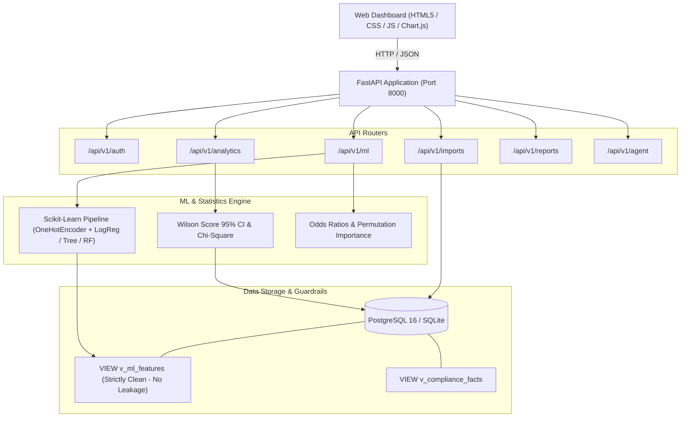
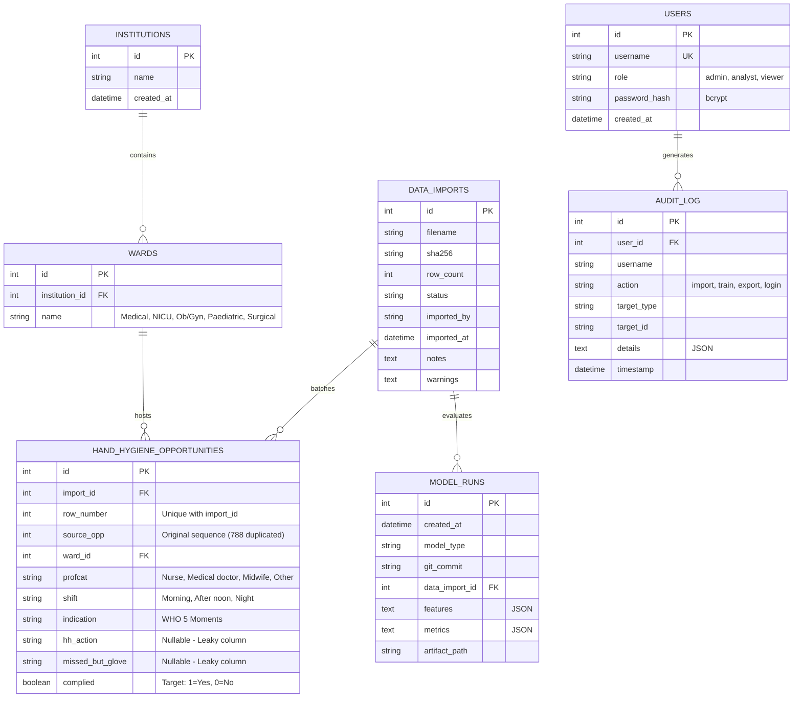

# BIOPRESS Analytics — Architecture & System Design Document

**Platform**: Software-only Hand Hygiene Compliance Analytics & Decision Support  
**Target Facility**: Debre Berhan Referral Hospital (Ethiopia, 2017 Cohort)  
**Version**: 1.0.0 Production Baseline  

---

## 1. High-Level System Architecture

BIOPRESS Analytics is organized into four distinct tiers:
1. **Presentation Tier (Frontend)**: Plain HTML5, CSS3, modern Vanilla JavaScript, and Chart.js with custom Wilson Confidence Interval plugins.
2. **Application Tier (Backend)**: FastAPI (Python 3.11) with modular routing, strict Pydantic v2 data contracts, and RBAC authentication.
3. **Analytics & Machine Learning Tier**: Scikit-Learn pipelines, SciPy statistical inference, and XAI Odds Ratio estimators.
4. **Data & Security Tier**: PostgreSQL 16 (production) / SQLite (local testing), secured SQL views (`v_ml_features`, `v_compliance_facts`), and bcrypt password hashing.



---

## 2. Entity-Relationship Diagram (ERD)

The database schema reflects only entities supported by observational audit data. No artificial worker or session entities are fabricated.



---

## 3. Secured SQL Views (Leakage Prevention)

To eliminate accidental model ingestion of target leakage columns, machine learning algorithms are restricted to the `v_ml_features` database view.

```sql
CREATE VIEW v_ml_features AS
SELECT 
    w.name AS ward,
    h.profcat,
    h.shift,
    h.indication,
    CASE WHEN h.complied = 1 THEN 1 ELSE 0 END AS complied
FROM hand_hygiene_opportunities h
JOIN wards w ON h.ward_id = w.id;
```
> [!IMPORTANT]
> The target leakage columns `hh_action` and `missed_but_glove` are strictly omitted from `v_ml_features`. Python unit tests verify that querying or requesting these columns immediately triggers runtime assertion failures.

---

## 4. Security & Threat Model

### 4.1 Role-Based Access Control (RBAC)
- **Viewer**: Read-only access to overview statistics, compliance charts, and audit summary reports.
- **Analyst**: Access to data explorer records, ML evaluation reports, and sanitized CSV exports.
- **Admin**: Full access including CSV upload, database commit, and triggering model re-training.

### 4.2 CSV Formula Injection (DDE) Mitigation
Spreadsheet programs (Excel, LibreOffice Calc) execute cells beginning with `=`, `+`, `-`, or `@` as formulas or shell calls. Every CSV export passes through `sanitize_csv_cell()` which prepends a single quote `'` to neutralize formula execution.

### 4.3 Data Minimization & Privacy Protection
- Observational data contains no patient names, medical record numbers (MRNs), or staff worker IDs.
- **Privacy Threshold**: Subgroup rates are withheld (`None`) when $n < 5$.
- **Small-Sample Guardrail**: Subgroups with $n < 30$ are explicitly flagged with small-sample confidence interval warnings.

### 4.4 Non-Disciplinary Use Policy
Hand hygiene rates describe systemic clinical moments and hospital environmental opportunities. Under no circumstances may model outputs or audit rates be utilized to rank, punish, or discipline individual healthcare personnel.
